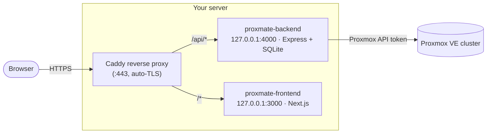
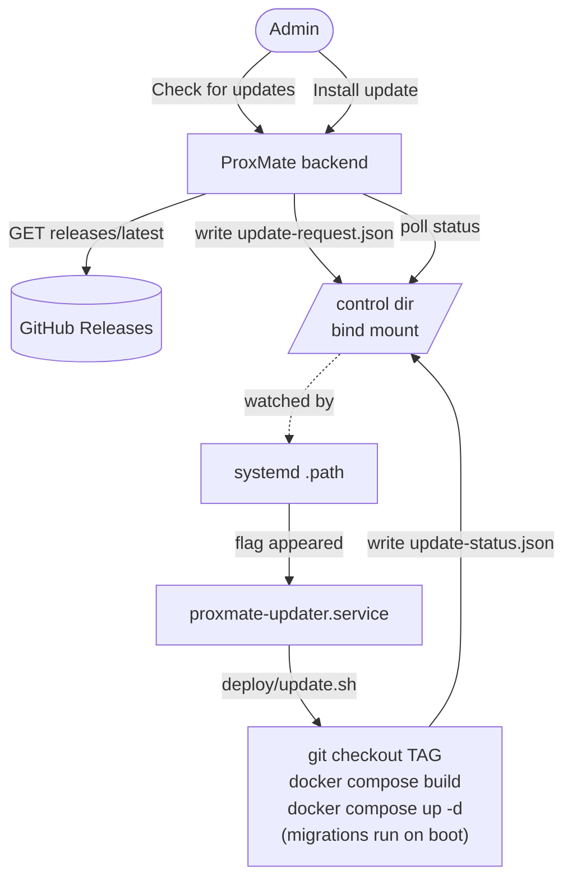
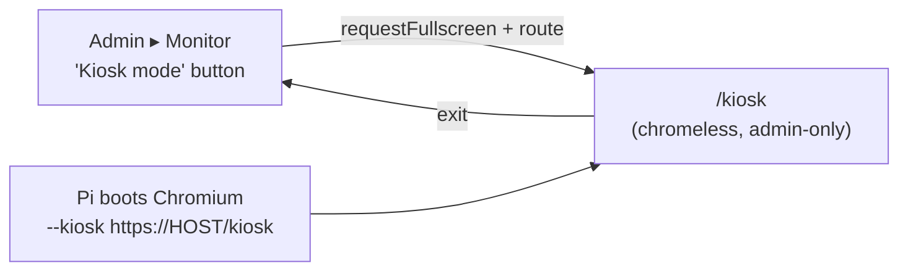

# ProxMate — Production Deployment Runbook

A step-by-step guide to deploying a production-ready ProxMate on your own
infrastructure: HTTPS, tenant network isolation, SMTP, Keycloak SSO, and all
two-step-authentication methods. Follow it top to bottom.

> **Why HTTPS is non-negotiable here:** passkeys (WebAuthn), `Secure` session
> cookies, and the OIDC SSO redirect all require a secure context. The whole
> deployment is built around **one HTTPS domain** behind a reverse proxy.

---

## 0. Target topology



- **One public domain** (e.g. `proxmate.example.com`). Frontend at `/`, API at `/api`.
  Same-origin ⇒ first-party cookies, passkey RP ID = the domain, SSO callback on the
  same domain. This avoids every cross-origin cookie headache.
- The backend reaches the **Proxmox cluster** over your management network using an
  API token. ProxMate never stores your Proxmox password.

---

## 1. Prerequisites

**On the server that will host ProxMate:**
- [ ] Linux host with Docker Engine + Docker Compose v2 (`docker compose version`).
- [ ] A domain/subdomain (`proxmate.example.com`) with an **A/AAAA record** pointing at the server's public IP.
- [ ] Ports **80 + 443** open to the internet (for Caddy + ACME). The app ports (3000/4000) stay bound to `127.0.0.1`.
- [ ] Outbound reachability to your **Proxmox API** (`https://<pve-host>:8006`) and, if used, your **Keycloak** and **SMTP relay**.

**On the Proxmox side:**
- [ ] A dedicated **API token** for ProxMate (see §2.2). 
- [ ] Decided on your **tenant isolation** model (see §2.1) — ideally a dedicated VLAN/SDN bridge.

**You'll generate/collect along the way:** `ENCRYPTION_KEY`, the Proxmox token id+secret, SMTP creds, and Keycloak client id+secret.

---

## 2. Network, VLAN & tenant isolation (Proxmox side)

ProxMate gives every tenant VM a per-VM Proxmox firewall (`policy_in=DROP`,
mac/ip-filter on, DNS to the gateway allowed, RFC1918 dropped, internet allowed).
**These rules only take effect once the Proxmox *cluster* firewall is enabled** —
ProxMate can do that for you safely from the admin UI (§7.3).

### 2.1 Choose an isolation model

- **Good — shared bridge + per-VM firewall + cluster firewall on.** Works on a
  default `vmbr0`. ProxMate's per-VM rules block tenant-to-tenant traffic once the
  cluster firewall is enforced.
- **Best — a dedicated VLAN or SDN zone for tenant VMs.** Put tenant NICs on an
  isolated VLAN (e.g. tag 50) or a Proxmox **SDN VNet** so tenants are L2-isolated
  from your management network by design.
  - Datacenter ▸ SDN ▸ Zones → add a **VLAN** (or **Simple**) zone; add a **VNet**
    (e.g. `tenants`, VLAN tag 50); **Apply**.
  - Set ProxMate's default bridge to that VNet in admin **Settings ▸ Proxmox tab ▸ VM defaults**
    after first run.
- Keep the **Proxmox management interface (8006) and SSH on a separate VLAN/subnet**
  the tenants can't reach.

### 2.2 Create the ProxMate API token (avoid the #1 pitfall)

Proxmox tokens default to **Privilege Separation ON**, which gives the token *no*
permissions even for root — storage lists come back empty and VM creation 403s.

```bash
# On a Proxmox node (as root). Create a user + token, OR use root@pam.
pveum user token add root@pam proxmate --privsep 0       # privsep OFF
# → copy the displayed token VALUE now; it is shown only once.
```
You'll enter `root@pam!proxmate` as the **Token ID** and that value as the **Secret**
during OOBE (§7).

> Prefer least privilege? You can scope a token with a role on a pool instead — but
> note the per-tenant Pool/ACL least-privilege model is still being validated
> (tracked separately). For now a privsep-off token is the supported path.

---

## 3. Get the code onto the server

```bash
git clone <your ProxMate repo URL> proxmate
cd proxmate
```

(Or copy the repo across with `rsync`/`scp`. Everything below runs from the repo root.)

---

## 4. Configure environment

```bash
cp .env.docker.example .env
openssl rand -hex 32          # copy the output into ENCRYPTION_KEY
nano .env
```

Fill in the **PRODUCTION** block (replace the domain). The key values:

| Variable | Production value | Why |
|---|---|---|
| `ENCRYPTION_KEY` | the 64-hex string you generated | Encrypts Proxmox token, JWT secret, SSO/SMTP secrets at rest. **Keep it stable** — changing it makes stored secrets unreadable. |
| `FRONTEND_URL` | `https://proxmate.example.com` | CORS allow-list + redirect targets. |
| `NEXT_PUBLIC_API_URL` | `https://proxmate.example.com/api` | Baked into the browser bundle at **build time**. |
| `BACKEND_PUBLIC_URL` | `https://proxmate.example.com` | Builds the SSO callback `…/api/auth/sso/callback`. |
| `WEBAUTHN_RP_ID` | `proxmate.example.com` | Passkey relying-party (domain only, no scheme/port). |
| `WEBAUTHN_ORIGIN` | `https://proxmate.example.com` | Passkey origin (full https origin). |
| `COOKIE_SECURE` | `true` | Send `Secure` cookies (HTTPS). |
| `TRUST_PROXY` | `1` | One proxy hop (Caddy) → real client IP for rate-limit + audit. |
| `BIND_ADDR` | `127.0.0.1` | Only the local reverse proxy can reach the app ports. |
| `PROXMATE_BACKUP_DIR` | *(recommended)* e.g. `/mnt/backups/proxmate-db` | **Where ProxMate's own database snapshots land on the HOST** (§12). The container-side path is fixed at `/var/backups/proxmate`; this chooses the host directory that gets mounted there. Creating a folder on the host does **nothing** unless it's set here — the backend runs in a container and can only write to paths mounted into it. Changing it requires `docker compose up -d backend` (a mount is only established at container-create time), not a restart. Default: `./backups` next to `docker-compose.yml`. |
| `BACKUP_DOWNLOAD_DIR` | *(optional)* e.g. `/backups` | **Enables tenant backup downloads.** Mount your backup share (the same NFS/CIFS/PBS-dir Proxmox writes vzdumps to) into the API container and point this at it. Tenants then get a **Download** button on each MateState that emails them a single-use, 1-hour link; ProxMate streams the file off this mount (the Proxmox API can't stream vzdump bytes). Requires SMTP. Leave unset to keep the feature off. |
| `RESTORE_UPLOAD_MAX_GB` | *(optional)* default `50` | Size cap for **restore-from-upload** (below). `0` disables the cap. |
| `SNIPPET_DIR` + `SNIPPET_STORAGE` | *(optional)* e.g. `/snippets` + `local` | **Enables on-demand cloud-init snippet writing.** Point `SNIPPET_DIR` at a snippets directory that is both mounted into the API container **and** backed by a Proxmox storage every node can read (an NFS export is ideal), and set `SNIPPET_STORAGE` to that storage's id (with the `snippets` content type enabled). ProxMate then writes the exact cloud-init extras a deploy needs, atomically, at deploy time — no per-node file placement. Leave unset to fall back to manual snippet pre-placement. |
| `METRICS_TOKEN` | *(recommended)* a random string | Guards `GET /metrics`. **In production `/metrics` returns 404 unless this is set** — there is no localhost exemption, so a Prometheus scrape from `127.0.0.1` gets a 404 too. Scrapers send `Authorization: Bearer <token>`. |
| `ALLOW_PRIVATE_OUTBOUND_URLS` | *(optional)* `true` | Admin-configured **webhooks** and **cloud-image URLs** are blocked from targeting private/loopback/metadata addresses (SSRF guard). Set `true` only if you legitimately point at a **LAN** service (self-hosted Mattermost/ntfy, a local image mirror). The scheme + no-credentials checks always stay enforced. |
| `MATESTATE_CRON` / `ACCESS_EXPIRY_CRON` | *(optional)* 5-field cron | Override the guest-backup schedule (default Sundays 03:00) and the compute-access-window sweep (default hourly at :20). |

> **`SNIPPET_DIR` and `BACKUP_DOWNLOAD_DIR` are CONTAINER paths.** Setting the variable is only
> half the job — the host directory must also be **mounted into the backend container**, or the
> path simply won't exist inside it. `docker-compose.yml` ships both mounts commented out next to
> the `proxmate-data` volume; uncomment the one you need and keep its container-side path identical
> to the variable. (This is the same container-boundary trap described for `PROXMATE_BACKUP_DIR`
> in §12.)

> **Restore from old build (upload a MateState backup).** When `BACKUP_DOWNLOAD_DIR` is
> mounted **read-write** (`rw`, not `:ro`), the create-VM wizard gains a **"Restore from old
> build"** source: a tenant uploads a vzdump archive they previously downloaded and ProxMate
> restores it as a new machine — the migration path between clusters or ProxMate instances.
> The upload is streamed onto the mount (the Proxmox API can't accept backup uploads), the
> embedded config is quota-checked via `vzdump extractconfig` before anything is restored,
> volumes are remapped onto the default disk storage, the guest gets fresh MAC addresses, and
> the tenant-isolation firewall is applied before first boot. The uploaded file is removed
> after the restore. Mount the share `:ro` to keep downloads but disable uploads.
> **Cloudflare note:** the free Cloudflare plan caps request bodies at ~100 MB, so multi-GB
> uploads through a Cloudflare Tunnel will be rejected at the edge — upload from the LAN /
> Tailscale origin instead, or raise the plan limit.

> If you ever change `NEXT_PUBLIC_API_URL`, you must **rebuild** the frontend image
> (it's compiled in, not read at runtime).

---

## 5. TLS + reverse proxy (Caddy)

Caddy terminates HTTPS on the host and routes to the two localhost-bound containers.

```bash
# Install Caddy (Debian/Ubuntu example): https://caddyserver.com/docs/install
sudo cp deploy/Caddyfile /etc/caddy/Caddyfile
sudo nano /etc/caddy/Caddyfile      # set your domain + ACME email
sudo systemctl reload caddy
```

Caddy will obtain and auto-renew a Let's Encrypt certificate as soon as DNS points
at the box and ports 80/443 are reachable. (Prefer nginx/Traefik? Mirror the same
routing: `/api/*` → `127.0.0.1:4000` with WebSocket upgrade, everything else →
`127.0.0.1:3000`.)

### Alternative: Cloudflare Tunnel (no open ports)

If you can't (or don't want to) open 80/443 — e.g. behind CGNAT — front ProxMate with
a **Cloudflare Tunnel** instead. TLS terminates at Cloudflare's edge and `cloudflared`
forwards plain HTTP to a **single local origin**, so you still need one merge-proxy that
joins `/api` and `/` onto one host:port. Run a small Caddy "merge-proxy" (no TLS):

```
# deploy/Caddyfile.proxy
:8184 {
	handle /api/* { reverse_proxy 127.0.0.1:4000 }
	handle       { reverse_proxy 127.0.0.1:3000 }
}
```
Start it (`auto_https off`), then in the Cloudflare Zero Trust dashboard point the public
hostname (`proxmate.example.com`) at `http://<host>:8184`. WebSockets (the noVNC console)
pass through automatically on proxied hostnames. The `.env` values are identical to the
reverse-proxy setup above (single HTTPS origin), and **no inbound ports** are exposed on
the host.

---

## 6. Build & launch

```bash
docker compose up -d --build
docker compose ps
docker compose logs -f backend     # watch "Applying database migrations…" then "Starting ProxMate API…"
```

The backend entrypoint runs `prisma migrate deploy` against the SQLite DB on the
named volume `proxmate-data`, so all auth migrations (cookies/CSRF, password reset,
2FA, passkeys, SSO, invite-2FA) apply automatically on first boot.

Browse to **https://proxmate.example.com** — you should land on the setup wizard.

---

## 7. First run (OOBE)

### 7.1 Create the owner + connect Proxmox
1. The setup wizard creates the **first admin (owner)** — choose a strong password.
2. Enter the **Proxmox host** (`https://<pve-host>:8006`), **Token ID**
   (`root@pam!proxmate`), and **Secret** from §2.2. Leave "verify SSL" off if your
   Proxmox uses a self-signed cert.
3. Set **VM defaults** (storage, bridge — point this at your tenant VLAN/VNet if you
   made one, ISO storage).

> **Scripting a deployment (CI/CD, Ansible, Terraform)?** §7.1a below skips this wizard
> entirely via environment variables.

### 7.1a Automatic first-time setup (skip the wizard)

Set these before the first boot and the backend walks the wizard itself — creates the
admin, saves and verifies the Proxmox connection, checks the defaults against the live
cluster, and finishes setup — with nothing to click through:

| Variable | Required | Notes |
|---|---|---|
| `PROXMATE_AUTO_SETUP` | — | Must be exactly `true`. Any other value (including unset) leaves the interactive wizard as the only path — nothing else below has any effect. |
| `ADMIN_EMAIL`, `ADMIN_PASSWORD` | yes | The owner account. Password 8+ characters, same rule as the wizard. |
| `ADMIN_DISPLAY_NAME` | no | Default `Administrator`. |
| `PROXMOX_HOST`, `PROXMOX_TOKEN_ID`, `PROXMOX_TOKEN_SECRET` | yes | Same values as step 7.1.2 above. |
| `PROXMOX_VERIFY_SSL` | no | Default `true`. Only the exact string `false` turns verification off — anything else (including a typo) stays strict. |
| `DEFAULT_STORAGE`, `DEFAULT_BRIDGE`, `DEFAULT_ISO_STORAGE` | yes | Same as step 7.1.3. Each is checked against what the token can actually see on the cluster — a typo refuses setup by name, not a vague "server defaults are not configured" later. |
| `DEFAULT_BACKUP_STORAGE` | no | Not offered by the interactive wizard at all; auto-setup can set it on first boot. |

```yaml
# docker-compose .env, or the backend service's `environment:` directly
PROXMATE_AUTO_SETUP=true
ADMIN_EMAIL=admin@example.com
ADMIN_PASSWORD=change-me-now
PROXMOX_HOST=https://192.168.1.100:8006
PROXMOX_TOKEN_ID=root@pam!proxmate
PROXMOX_TOKEN_SECRET=xxxxxxxx-xxxx-xxxx-xxxx-xxxxxxxxxxxx
DEFAULT_STORAGE=local-zfs
DEFAULT_BRIDGE=vmbr0
DEFAULT_ISO_STORAGE=local
```

**What to expect:**
- **Idempotent.** Runs on every container start, but `isSetupComplete()` is checked
  first — once setup finishes, this permanently becomes a no-op for that database, even
  if the env vars are left in place or changed. It will never re-apply itself over
  settings an admin later changes by hand in the UI.
- **Resumable — but only for its own admin.** If the container is killed partway
  through (admin created, Proxmox not yet saved), the next boot picks up where it left
  off rather than failing with "Admin account already exists". If an admin already
  exists for a DIFFERENT reason — the interactive wizard was used once before
  `PROXMATE_AUTO_SETUP` was set, or `ADMIN_EMAIL` changed between attempts — this
  refuses with a clear error instead of silently treating it as its own (that account's
  password is unknown here). Match `ADMIN_EMAIL` to the existing account, or delete it,
  to proceed. Left unresolved, `/setup` would otherwise sit stuck showing step 2 forever
  — the UI sees `adminExists: true` but `setupComplete` never becomes `true`.
- **Fails closed, on purpose.** A bad token, an unreachable host, or a storage/bridge
  name that doesn't exist on the cluster makes the container exit non-zero instead of
  completing setup against a broken connection. Under `restart: unless-stopped` that
  means it crash-loops — self-healing if Proxmox simply isn't up yet during
  orchestrated provisioning, loud if the input is actually wrong. Check
  `docker compose logs backend` for the `[auto-setup]`-prefixed line naming exactly
  what's missing or wrong.
- These are the same validations and the same `/access/permissions`-based connection
  check as the interactive wizard's "Test" button — nothing about auto-setup is less
  strict.

**Also configure SSO, as part of the same run** — set `SSO_ISSUER` + `SSO_CLIENT_ID` (+
`SSO_CLIENT_SECRET`, required alongside them even though the admin UI itself allows
leaving a secret blank on an *ongoing* update — a first-time configure with none stored
yet would just leave SSO broken). Saved with the exact function the admin UI's "Save SSO
settings" button calls, so there's no separate, weaker path:

```yaml
SSO_ISSUER=https://idp.example.com/realms/example
SSO_CLIENT_ID=proxmate
SSO_CLIENT_SECRET=xxxxxxxx-xxxx-xxxx-xxxx-xxxxxxxxxxxx
SSO_GROUPS_CLAIM=roles
SSO_ADMIN_GROUP=proxmate-admins
```

| Variable | Required | Notes |
|---|---|---|
| `SSO_ISSUER`, `SSO_CLIENT_ID` | — | Setting either opts in; both are then required, along with `SSO_CLIENT_SECRET`. Neither set: SSO is left exactly as the wizard would leave it (unconfigured). |
| `SSO_CLIENT_SECRET` | yes, once opted in | See above — required here even though the admin UI allows blank on a later update. |
| `SSO_ENABLED` | no | Default `true` — configuring it at all is taken as wanting it on. Set to the exact string `false` to save it staged but disabled. |
| `SSO_GROUPS_CLAIM` | no | ID-token claim read for group/role membership. ProxMate's own default (unset here) is `groups`. |
| `SSO_ADMIN_GROUP` | no | Membership promotes to admin on login (never auto-demotes). **Only takes effect for a brand-new account if `SSO_ALLOW_SIGNUP=true` too** — otherwise a user with no existing account is refused before the admin-group check runs. |
| `SSO_ALLOW_SIGNUP` | no | Default `false` (ProxMate's own base default) — auto-provisioning brand-new accounts widens who can reach this ProxMate, so it stays off unless the exact string `true` is set. |
| `SSO_SCOPES`, `SSO_BUTTON_LABEL`, `SSO_ACCESS_ROLES` | no | Same meaning as the admin UI's SSO card. |
| `SSO_NEW_USER_CPU`, `SSO_NEW_USER_RAM`, `SSO_NEW_USER_STORAGE` | no | Default `0` (none) — quota for a newly auto-provisioned SSO user. |

### 7.2 Smoke-test the core
- Dashboard shows live cluster capacity (admins see cluster stats).
- Create a tiny test VM (or deploy from a template / cloud-init image) → start →
  open the **noVNC console** (this exercises the WebSocket relay through Caddy) → delete.

### 7.3 Turn on tenant isolation enforcement
- Admin **Settings ▸ Proxmox tab ▸ Tenant network isolation** → click **Enable enforcement**. ProxMate
  first adds management allow-rules (web 8006 + SSH 22 on the auto-derived
  `suggestedMgmtCidr`) **before** flipping the datacenter firewall on, so you don't
  lock yourself out. Confirm the suggested CIDR matches your mgmt network.
- Verify you can still reach Proxmox (8006) and SSH, then confirm tenant VMs can't
  reach each other / your mgmt subnet.

---

## 8. Email (SMTP)

Enables password-reset emails — without it, resets fall back to an admin-approval queue.
SMTP also gates a lot more than resets, so it's worth configuring even if you're happy
approving resets by hand:

- **Compute access-window warnings** (§12b) — the 7-day and 1-day notices before a tenant's
  access lapses, plus the `access.expired` notification to admins. Without SMTP the
  suspension still happens, just silently.
- **Invites** sent by email, **account-lockout** alerts, backup-failure and
  provisioning-error notifications, and the **single-use backup download links**
  (`BACKUP_DOWNLOAD_DIR`, §4) — which cannot work at all without it.

All of it renders from one branded template, so verifying a single send covers the lot.

1. Admin **Settings ▸ Notifications tab ▸ Email (SMTP)** → enter host, port (587 STARTTLS or 465 TLS),
   username, password, and a From address. Point it at any relay (e.g. the same one
   your Proxmox notifications use).
2. Click **Save**, then **Test** (verifies the connection/credentials).
3. Confirm end-to-end: log out → **Forgot your password?** → check the inbox for the
   reset link → reset → log in.

---

## 9. Single sign-on with Keycloak (OIDC)

### 9.1 In Keycloak
1. Create (or pick) a **realm**, e.g. `proxmate`.
2. **Clients ▸ Create client** → OpenID Connect, Client ID `proxmate` → Next.
3. **Client authentication: ON** (confidential), **Standard flow** enabled → Save.
4. **Valid redirect URIs:** `https://proxmate.example.com/api/auth/sso/callback`
   (this exact URL is shown in ProxMate's SSO settings card — copy it from there).
5. **Credentials** tab → copy the **Client secret**.
6. **Group→admin mapping (optional but recommended):**
   - Create a group, e.g. `proxmate-admins`, and add your admin user to it.
   - Add a **Client scope / protocol mapper** of type **Group Membership**:
     Token Claim Name = `groups`, **Full group path = OFF**, include in ID token.
   - This puts `"groups": ["proxmate-admins"]` in the ID token.
7. Your **Issuer URL** is `https://<keycloak-host>/realms/proxmate`
   (it must serve `…/realms/proxmate/.well-known/openid-configuration`).

### 9.2 In ProxMate
Admin **Settings ▸ Access tab ▸ Single sign-on (OIDC)**:
- **Issuer URL:** `https://<keycloak-host>/realms/proxmate`
- **Client ID / Client secret:** from Keycloak
- **Scopes:** `openid profile email`
- **Groups claim:** `groups` · **Admin group:** `proxmate-admins`
- **Auto-create accounts (JIT):** off = only existing/invited users may sign in
  (recommended for invite-only); on = any Keycloak user is provisioned on first login.
- Tick **Enable SSO**, set the button label, **Save**, then **Test** (runs discovery).

### 9.3 Test the SSO flow
- Log out → the login page shows your **SSO button** → sign in via Keycloak → you
  land on the dashboard.
- **Hybrid check:** a user invited in ProxMate (local account) who signs in via
  Keycloak with the **same email** is linked automatically.
- **Admin mapping:** a Keycloak user in `proxmate-admins` becomes an admin (members
  are promoted; the mapping never auto-demotes an existing admin/owner).

### 9.4 One ProxMate per environment (role-gated access + scoped Proxmox account)

Use this when a ProxMate instance serves **one environment** (an exercise network, a lab, a
team) and must not be able to touch anything else. Isolation comes from two independent layers:

1. **WHERE — the Proxmox account.** Configure ProxMate (OOBE, or Settings ▸ Proxmox) with a
   *dedicated* Proxmox user + API token whose ACLs cover only that environment: its resource
   pool, its SDN zone, the shared template pool and the storages of the pool. Proxmox itself
   refuses anything outside — there is nothing in ProxMate to bypass.
2. **WHO — a role claim.** Set **Access roles** (Settings ▸ Access ▸ Single sign-on). A non-admin
   user can only sign in when the ID token carries at least one of those values, e.g.
   `developer-env-01, developer-env` (the *groups/roles claim* above says which claim to read —
   Keycloak client roles arrive flat in `roles`). Users without one are refused at the SSO
   callback before anything is linked or created; admins are never locked out. Revocation takes
   effect at the next sign-in (sessions last up to 24 h).

**What the Proxmox account needs** (privileges, on the paths it should reach):

| Need | Privilege |
|---|---|
| See guests, storages, pools | `VM.Audit`, `Datastore.Audit`, `Pool.Audit` |
| Create / clone into the pool | `VM.Allocate`, `VM.Clone` (on the template pool), `Datastore.AllocateSpace` |
| Configure and run guests | `VM.Config.CPU/Memory/Disk/Network/Cloudinit/Options`, `VM.PowerMgmt`, `VM.Console`, `VM.Snapshot`, `VM.GuestAgent.*` |
| Attach NICs to the environment's networks | `SDN.Use` (and `SDN.Audit` to list them) on the zone |
| Node health, capacity | `Sys.Audit` on `/` |

Use a token with **privilege separation off** (`pveum user token add <user> <id> --privsep 0`), or
grant the token itself. Settings ▸ Proxmox ▸ **Test** reports what is missing.

**Let users choose where machines go** — Settings ▸ Proxmox ▸ *Users choose pool, network and
storage*. With it on, a non-admin user must pick a pool, an SDN network and a storage for each
machine and is offered only what the account can use (pools it can allocate in, networks it can
`SDN.Use`, storages it can allocate on, templates it can clone). The API re-checks every choice,
so a hand-crafted request gets the same answer, and a failed check refuses the deploy rather than
guessing. Answers are cached for 30 seconds. Admins keep the classic defaults.

**Behaviour to know about** (with placement on)
- Machines do **not** get ProxMate's own tenant firewall or VLAN tag: the SDN zone is the
  boundary, and the firewall's private-range drops would cut them off from the environment they
  were deployed to join.
- Guests record their pool and network; **duplicates stay in the same pool and network**.
  **Rebuild** and **restore from upload** are unavailable (both re-provision from server defaults).
- Quotas still apply on top. A newly auto-created SSO user gets the *quota for auto-created SSO
  users* configured in the same card (0 = none, so they cannot deploy until you raise it).

**Restrict ISO installs to admins** — Settings ▸ Proxmox ▸ *Only admins may install from ISO*. A
non-admin's ISO picker otherwise shows everything Proxmox classifies as `content=iso` on the
configured ISO storage — which includes OTHER GUESTS' OWN cloud-init seed volumes (a NoCloud
datasource is itself an ISO9660 image, so Proxmox tags it `content=iso` too), not just genuinely
shared install media. On a cluster where ISO storage is shared across tenants, that can mean
seeing — and being able to attach — another tenant's cloud-init seed. Turning this on hides
"Custom VM (install from ISO)" in the wizard for non-admins and refuses it on `POST /api/vms` too,
so it's a real restriction, not a hidden button; templates and containers are unaffected.

---

## 10. Two-step authentication — full test matrix

Run these against the production HTTPS site (passkeys won't work otherwise).

| # | What | How | Expected |
|---|---|---|---|
| 1 | **TOTP enroll** | `/security` → Set up 2FA → scan QR (Google Authenticator/1Password/Authy) → enter code | 2FA on; **10 recovery codes** shown once |
| 2 | **TOTP login** | Log out → log in with password | Prompted for a 6-digit code; correct → in, wrong → rejected |
| 3 | **Recovery code** | At the 2FA prompt, enter a recovery code | Works once; reusing the same code is rejected |
| 4 | **Passkey enroll** | `/security` → Passkeys → Add a passkey | Browser biometric/security-key prompt; passkey listed |
| 5 | **Passwordless passkey login** | Log out → **Sign in with a passkey** | Authenticate with the device; lands on dashboard (skips password + TOTP) |
| 6 | **Invite-enforced 2FA** | Create an invite with **Require two-step authentication** ticked → register through it | New user is corralled to `/security` and **can't use VMs** until they enroll TOTP or a passkey |
| 7 | **SSO exemption** | An SSO-linked user with require-2FA | Not forced into local 2FA (their IdP handles it) |

---

## 11. Security hardening checklist

- [ ] **Host firewall:** only 80/443 (and your admin SSH) open to the world; app
      ports stay on `127.0.0.1`.
- [ ] **`ENCRYPTION_KEY`** backed up in a secret manager — losing it orphans every stored secret
      (the Proxmox token, SMTP creds, tenant AI keys, TOTP secrets). A database backup **without
      this key cannot be restored usefully** — treat the key and the DB backups as a pair, stored
      in different places than the host itself.
- [ ] **`.env` permissions:** `chmod 600 .env`; never commit it.
- [ ] **Proxmox isolation enforcement ON** (§7.3) and verified.
- [ ] **Backups (built-in):** set `PROXMATE_BACKUP_DIR` in `.env` to where snapshots should land
      on the **host**, then confirm the directory under **Admin → Settings → Maintenance →
      App-database backups**. ProxMate snapshots its own DB nightly (`VACUUM INTO`, consistent on
      the live DB) with rolling retention. Use **Back up now** to prove the path works.
      Schedule override: `APPDB_BACKUP_CRON` (default nightly 02:30). See §12.
- [ ] **Backups (manual alternative):** snapshot the `proxmate-data` volume —
      `docker run --rm -v proxmate_proxmate-data:/data -v "$PWD":/backup alpine tar czf /backup/proxmate-db-$(date +%F).tgz -C /data .`
- [ ] **Updates:** `git pull && docker compose up -d --build` (migrations apply on boot).
- [ ] Consider enforcing **2FA on the owner/admin** account immediately after setup.

---

## 12. App-database backups

ProxMate can snapshot **its own database** (users, VM records, settings, encrypted
secrets) on a schedule. This is separate from MateStates, which back up the guests.

### The one thing that trips people up

ProxMate runs **in a container**. It can only write to directories that were
**mounted into** that container from the host. Creating a folder on the host and
typing its path into the app does *not* work — the container has its own
filesystem, so `/srv/backups` on the host and `/srv/backups` in the container are
unrelated paths.

That is why the host directory is chosen with an environment variable, not in the
app: the mount has to exist before the container starts.

### Setup

1. In `.env`, point `PROXMATE_BACKUP_DIR` at the host directory you want:

   ```bash
   PROXMATE_BACKUP_DIR=/mnt/backups/proxmate
   ```

   Prefer a disk that is **not** the one holding the database, ideally an
   off-host mount (NFS/CIFS) so losing the host doesn't lose the backups with it.
   The default is `./backups` next to `docker-compose.yml`, which works out of
   the box but lives on the same machine.

2. Make sure the directory is writable by the container's non-root user
   (uid 1000), then recreate the backend so the mount is picked up:

   ```bash
   sudo mkdir -p /mnt/backups/proxmate && sudo chown 1000:1000 /mnt/backups/proxmate
   docker compose up -d backend
   ```

3. In **Admin → Settings → Maintenance → App-database backups**, the directory
   should already read `/var/backups/proxmate` — the fixed container-side path
   your host directory is mounted onto. Set **Keep** (rolling retention) and
   press **Back up now** to prove the whole path works.

Snapshots are named `proxmate-appdb-YYYYMMDD-HHMMSS.db`. Retention only ever
deletes files matching that pattern, so anything else in the directory is safe.

Schedule override: `APPDB_BACKUP_CRON` (default nightly 02:30).

### Restoring

A snapshot is a plain SQLite database file. To restore:

```bash
docker compose stop backend
docker run --rm -v proxmate_proxmate-data:/data -v /mnt/backups/proxmate:/src alpine   cp /src/proxmate-appdb-20260729-023000.db /data/proxmate.db
docker compose up -d backend
```

Migrations run automatically on start, so restoring an older snapshot onto a
newer ProxMate is fine.

> **The backup is useless without the matching `ENCRYPTION_KEY`.** Every stored
> secret — the Proxmox API token, SMTP credentials, TOTP secrets, tenant AI keys —
> is encrypted with it. Restoring a database with a different key leaves the app
> running but unable to decrypt any of them. Back the key up separately from the
> database, in a password manager or secret store.

Take a copy of the current database before restoring over it, so a wrong choice
of snapshot is reversible.

> **Get `ENCRYPTION_KEY` off this host.** The key never changes, so one copy in a
> password manager or secret store closes the risk permanently. Snapshots stored on a
> second disk in the same machine do **not** protect you: lose the chassis and every
> secret inside those backups is undecryptable. Do this now rather than at restore time.

---

## 12b. Compute access windows (time-boxed tenants)

Invites can grant access for a **fixed term** or **never expire**. The clock is anchored at
sign-up (not at invite creation), and admins can override any user's window afterwards under
**Settings ▸ Access**.

What operators need to know before handing out invites:

- **Expiry suspends, it never deletes.** When a window closes the tenant's VMs are stopped and
  sign-in is refused, but nothing is destroyed — extending the window restores access intact.
- **Enforcement is everywhere**, not just at login: the console WebSocket, the IDE proxy, and
  both API-token families all check it, so an expired tenant can't keep working through a
  still-open tab or a saved token.
- **Admins never expire.**
- A sweep runs **hourly at :20**, with a catch-up shortly after boot — so a window that lapsed
  while the host was down is still enforced on the way back up. Override the schedule with
  `ACCESS_EXPIRY_CRON` (§4).
- **Warning emails (7-day and 1-day) and the admin `access.expired` notification require SMTP
  (§8).** Without it, tenants get suspended with no warning.

---

## 13. Final verification checklist

- [ ] `https://proxmate.example.com` loads over a valid certificate.
- [ ] OOBE done; Proxmox connected; a test VM created, console opened, deleted.
- [ ] Tenant isolation enforcement on; mgmt (8006/SSH) still reachable; tenants isolated.
- [ ] SMTP test passes; password-reset email round-trips.
- [ ] SSO button works; hybrid email-link + admin-group mapping verified.
- [ ] TOTP, recovery codes, passkeys, and invite-enforced 2FA all behave per §10.
- [ ] Audit log (admin ▸ Audit) shows logins, 2FA/passkey/SSO events.

---

## 14. Updating ProxMate

ProxMate ships an in-app updater. **Admin ▸ Settings ▸ Maintenance tab ▸ Updates** shows your running
version and a **Check for updates** button that reads the latest **GitHub Release**;
if a newer one exists it shows the release notes and lets you decide whether to apply it.

Because a container can't rebuild and restart itself, the actual update is done by a
**host-side script** (`deploy/update.sh`). You can run that by hand, or wire up the
**opt-in one-click** button which hands the job to the host via a systemd unit.



### 14.1 Publishing a release (so there's a "Latest" to find)

The check compares `backend/package.json`'s `version` against the latest GitHub Release tag.
To cut one:

```bash
# bump backend/package.json "version" (e.g. 0.2.0), then:
git commit -am "release: v0.2.0"
git tag v0.2.0
git push origin main --tags
```

`.github/workflows/release.yml` turns the pushed `v*` tag into a published Release with
auto-generated notes. (Manual alternative: `gh release create v0.2.0 --generate-notes`.)

> Set `UPDATE_REPO` in `.env` if you track a fork instead of the upstream repo.

### 14.2 Manual update (no host changes needed)

```bash
cd /opt/proxmate
git fetch --tags
./deploy/update.sh            # newest vX.Y.Z tag
./deploy/update.sh v0.2.0     # or a specific tag
```

The script checks out the tag, runs `docker compose build` + `up -d`, and the backend
applies DB migrations on boot (`docker-entrypoint.sh`). **Back up the DB first** (the
`proxmate-data` volume) so you can roll back. Rollback = `./deploy/update.sh <previous-tag>`.

### 14.3 Enabling the one-click "Install update" button

1. **Mount the control dir + enable the flag** — in `docker-compose.yml`, uncomment
   `- ./deploy/update-control:/control` under the backend `volumes`, and in `.env` set:
   ```
   SELF_UPDATE_ENABLED=true
   ```
   Then `docker compose up -d` to apply.
2. **Install the host updater unit** (as root; edit `PROXMATE_DIR` in the unit if your
   checkout isn't `/opt/proxmate`):
   ```bash
   cp deploy/proxmate-updater.service deploy/proxmate-updater.path /etc/systemd/system/
   systemctl daemon-reload
   systemctl enable --now proxmate-updater.path
   ```
3. Now **Install update** in the UI drops a request flag the unit picks up; the card polls
   the host's status file and shows progress, then a **Reload** when it's done.

> **Security note:** the app itself never runs Docker or git — it only writes one JSON
> flag in the bind-mounted control dir. All privileged work lives in `update.sh`, run by
> the host's systemd. Leave `SELF_UPDATE_ENABLED=false` (the default) to keep the apply
> path entirely manual.

---

## 15. Rack kiosk mode (touch panel)

ProxMate has a full-screen, touch-friendly **kiosk** view designed for a small panel mounted
on/near the cluster (e.g. a Raspberry Pi Touch Display 2 at 1280×720). It shows an at-a-glance
**command center** — cluster CPU/memory/storage gauges, per-node health + quorum, VM
running/stopped counts, trend sparklines, a live activity feed with tap-to-filter, and a **VMs**
tab of live per-guest cards.

> **The kiosk is monitoring only (since v0.8.6).** The VM cards carry **no power controls** and no
> links off the panel — an unattended screen anyone can walk up to must not be able to stop a
> tenant's VM, or navigate out of kiosk mode and thereby walk around the exit gate. The panel also
> shows no tenant identities (no owner emails or display names).

- **Enter from the app:** **Admin ▸ Monitor ▸ "Kiosk mode"**. The tap requests browser
  fullscreen (a user gesture is required) and routes to the chromeless kiosk.
- **Exit requires re-authentication.** Tapping **X (close)** opens a full-screen unlock gate
  offering a passkey, the admin-set exit PIN, or the account password; only on success does it
  leave fullscreen and route to **Admin ▸ Monitor**. The **fullscreen toggle** switches
  full-screen on and off.
- **Admin-only:** the kiosk shows cluster-wide data, so it's gated to admins (and the underlying
  `/api/admin/*` feeds are admin-gated server-side).
- It keeps the panel awake via the **Screen Wake Lock API** and hides the cursor for a true
  appliance feel.



### 15.1 Auto-launch on the Raspberry Pi (boot straight into kiosk)

`/kiosk` is a stable deep link. For the panel to come up in fullscreen kiosk after a reboot, point
Chromium at it with the `--kiosk` flag (browsers can't self-trigger OS-level fullscreen without a
user gesture, so the flag does it). Example for a Pi running a desktop session — create
`~/.config/autostart/proxmate-kiosk.desktop`:

```ini
[Desktop Entry]
Type=Application
Name=ProxMate Kiosk
Exec=chromium-browser --kiosk --noerrdialogs --disable-infobars --incognito https://proxmate.example.com/kiosk
X-GNOME-Autostart-enabled=true
```

Notes:
- The browser must already hold a logged-in **admin** session (sign in once on the panel; the
  `proxmate_session` cookie persists). The panel stays signed in by design — set an **exit PIN**
  (or enrol a passkey) so leaving kiosk mode still demands a credential, since anyone can physically
  touch the screen. The kiosk itself is read-only, so a passer-by can look but not act.
- Use the externally reachable origin (the same one in `NEXT_PUBLIC_SITE_URL` / your tunnel host).
- To keep the Pi display from blanking at the OS level too, disable DPMS/screen-blanking in your
  Pi's display settings (the in-app Wake Lock covers the browser, but the OS may still blank).

---

## 16. ProxMate IDE (optional, in-guest editor + AI agent)

If you want the per-VM browser IDE, the full setup + security model is in
[`docs/proxmate-ide.md`](docs/proxmate-ide.md). The production essentials:

- **Reachability:** the ProxMate host must reach tenant VM IPs on **TCP :8080**. On a flat
  network this is automatic; on a non-flat one you provide the routing (Tailscale subnet route,
  VPN, static route). ProxMate can't create it.
- **`BACKEND_PUBLIC_URL` must be your https origin** — the in-guest AI agent's gateway URL is built
  from it directly. Since v0.8.0 the configured value wins outright; deriving the scheme from
  `X-Forwarded-Proto` proved unreliable behind a proxy that rewrites it (an http URL gets 301'd,
  which breaks the agent's POST). Header derivation remains only a fallback for bare dev setups.
- **Firewall:** with isolation on, ProxMate opens a managed, infra-scoped `:8080` pinhole on each
  IDE VM, scoped to **`ide_ingress_cidr`** — set it to the address ProxMate's traffic arrives from
  (the backend host on a flat LAN; the subnet-router node's LAN IP when routed).
- **Guest specs:** IDE VMs need the **qemu-guest-agent** running, **>= 8 GB RAM** (`ide_min_ram_mb`),
  and AVX (ProxMate sets `cpu: host` automatically; reboot to apply).
- Enable + configure models in **admin Settings ▸ IDE tab**.

Prefer an agent to do it? [`DEPLOY_WITH_CLAUDE.md`](DEPLOY_WITH_CLAUDE.md) covers the IDE in §7.

---

## 17. Troubleshooting

**"EACCES: permission denied, mkdir …" when saving the app-database backup
directory.** The path isn't mounted into the backend container — ProxMate can
only write to directories mounted in from the host, and creating the folder on
the host is not enough on its own. Set `PROXMATE_BACKUP_DIR` in `.env` and
recreate the backend (`docker compose up -d backend`); the in-app field should
then read `/var/backups/proxmate`. See §12.

| Symptom | Likely cause / fix |
|---|---|
| Passkey enroll/login fails silently | Not HTTPS, or `WEBAUTHN_RP_ID`/`WEBAUTHN_ORIGIN` don't match the domain in the browser bar. RP ID = domain only, ORIGIN = full `https://…`. |
| Logged out immediately / cookies not sticking | `COOKIE_SECURE=true` requires HTTPS; make sure you're on the HTTPS origin and `FRONTEND_URL`/`NEXT_PUBLIC_API_URL` use the same domain. |
| SSO: "redirect_uri mismatch" | The redirect URI in Keycloak must be **exactly** `${BACKEND_PUBLIC_URL}/api/auth/sso/callback`. |
| SSO: "Your account has no access to this environment" | The token carries none of the **Access roles**. Check the claim name (Groups/roles claim) and that the role is emitted in the ID token, or clear Access roles to disable the gate. |
| Deploy refused: "This environment's Proxmox account isn't allowed to … (<privilege> on <path>)" | The named privilege is missing on that path for ProxMate's Proxmox account (§9.4). Grant it in Proxmox (or pick a pool/network/storage it can use); answers are cached ≤30 s. |
| Wizard shows empty Pool/Network/Storage lists | The Proxmox account holds `VM.Allocate` / `SDN.Use` / `Datastore.AllocateSpace` on nothing that exists yet — fix its ACLs; use Settings ▸ Proxmox ▸ Test. |
| SSO: discovery/Test fails | Issuer must serve `/.well-known/openid-configuration`; check the client secret and that the realm name is right. |
| Proxmox storage empty / VM create 403 | Token has **Privilege Separation ON** — recreate with `--privsep 0` (§2.2). |
| Container crash-loops right after a fresh deploy, log shows `[auto-setup] …` | `PROXMATE_AUTO_SETUP=true` (§7.1a) found a bad input — the line names exactly which var and why (unreachable host, bad token, or a storage/bridge/ISO storage that doesn't exist on the cluster). Fix the var and restart; it resumes rather than redoing finished steps. |
| Rate-limit/audit shows the proxy IP, not the client | Set `TRUST_PROXY=1` (already in the production `.env`). |
| Console (noVNC) won't connect | Ensure the reverse proxy forwards WebSocket upgrades on `/api/*` (Caddy does automatically). |
| Changed `NEXT_PUBLIC_API_URL` but the browser still calls the old URL | Rebuild the frontend image: `docker compose up -d --build frontend`. |

---

*Companion doc: the root `completed-tasks.md`.*
